# RapidReader 0.1.0

Custom RSVP Nano firmware for **Waveshare ESP32-S3 Touch LCD 3.49 Rev2**
(16 MB flash, 8 MB OPI PSRAM). The firmware identifies itself as
`rapid-reader-0.1.0`; the PlatformIO environment is `rapid_reader_0_1_0`.

## Interface

- Russian is the default. Settings → Language switches between Русский and English.
  Both translations and the Cyrillic UI/reading fonts are embedded in firmware;
  no language pack or network connection is needed.
- The boot screen uses the RR monogram from `RSVPConverter/public/favicon.svg`.
  The SIGNALIS-inspired interface combines that brand's signal red with charcoal
  panels, pale text, fine borders, square controls and numbered top navigation.
  Rapid Mono, derived from IBM Plex Mono, supplies native-size Latin and Cyrillic
  interface text. Book typography remains separate.
- The menu contains reading and Settings. Reading retains resume, chapters and
  library. Settings directly contains brightness, theme, language, standby timer
  and screensaver, formerly under Display.
- Reading speed is calibrated to a five-letter word. Shorter words appear for
  less time and longer words for more time; Russian and English use Unicode
  letter/digit counts, excluding punctuation and combining marks. Sentence and
  punctuation pauses remain separate. The guide explains the five-letter target.
- Library and Chapters use the same large list rows and horizontal swipes,
  with tall chevrons and a two-pixel stroke at both sides: brighter in available
  directions and faint at the first/last page. Their full-height touch areas
  accept plain clicks/taps in both directions. Swiping only changes pages;
  tap a row to open a book or chapter. Paging stops at either end.
  Progress, authors and long Cyrillic titles remain readable.
- Device, Focus, network/update menus, reading/pacing/layout configuration and
  per-book font controls are hidden. Hidden reading preferences reset to their
  upstream defaults on load and on settings edits. Reading speed stays adjustable
  and is saved. Display preferences are saved normally. Network and update
  settings remain at their defaults, including startup update checks being off.
- USB serial transfers remain compatible with the existing companion/converter.
  Books still require a FAT32 microSD card; embedded language assets do not
  replace book storage.
- The application initializes the display before serial waiting, diagnostics and
  encrypted NVS setup. The backlight stays off until the first RR frame is ready.
  The logo stays visible through library/display/reader preparation, with localized
  phase labels, then shows Ready before opening the reader. The ROM and second-stage
  bootloader still execute before this application-controlled display initialization.
- A four-step first-boot guide covers USB/microSD books, BOOT/PWR controls,
  paused-reading gestures, and display settings. It follows the device language
  (Russian by default) and uses the same RR logo, panels and signal-red progress
  marks. Use Back/Next or BOOT (next) / a short PWR press (back); Skip is available
  on every step. Finishing opens the reading menu. Reading stays paused and the
  guide also works without a book or SD card. Completing or skipping saves a
  versioned flag in internal NVS, so subsequent boots go straight to the reader.
  An interrupted guide is shown again; erasing NVS resets it. Display Settings
  keeps its existing limited set of controls.
- On-device USB companion and memory-card screens use the same RR branding.
  Connection, reception, response transmission and processing messages follow the
  selected device language. Russian is the default; file names are preserved.
  Transfer percentages use actual received/sent byte counts. Browser UI and the
  serial handshake/frame format are unchanged.

The original board environments remain available for upstream development.
Product behavior is enabled only with `RAPID_READER=1`.

## Screen previews

Rendered with the production UI and Arduino_GFX rasterizer at 640×172.


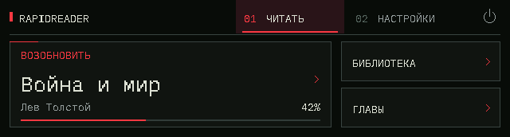

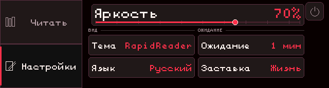

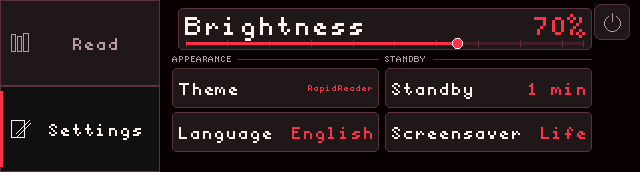

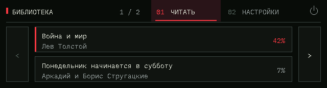

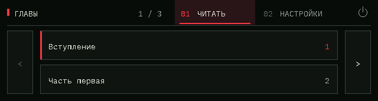

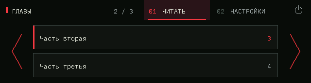

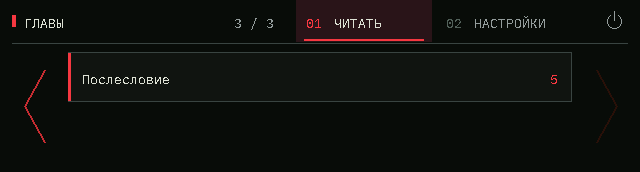

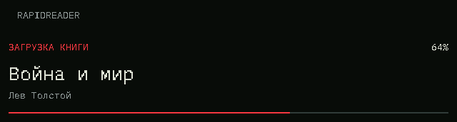

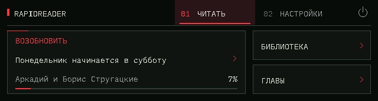


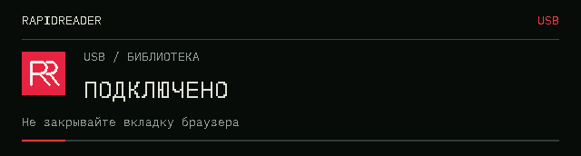

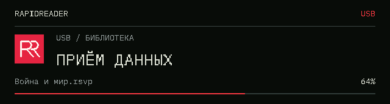

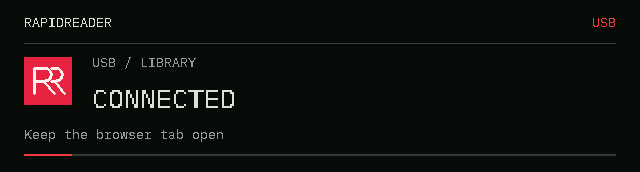

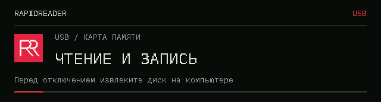

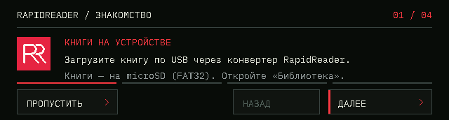

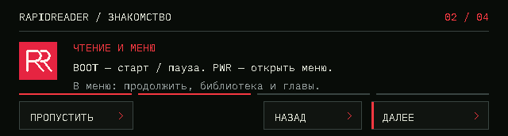

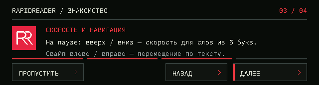

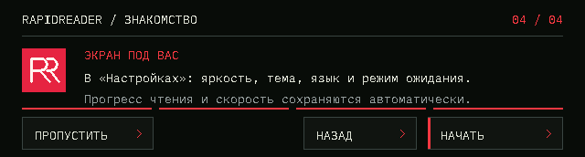

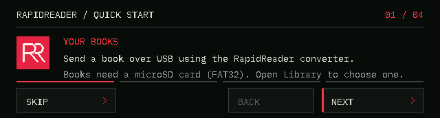

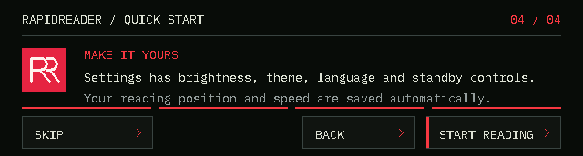

## Dynamic word timing

The selected WPM is the target for a five-letter word. For a token containing
`L` Unicode letters/digits, RapidReader uses:

```text
word_ms = round((60000 / WPM) * (L + 5) / 10)
duration_ms = word_ms + punctuation_pause_ms
```

Half of the baseline interval is fixed recognition time; each letter adds a
tenth. This gives every ordinary word length a smooth increase, with a
five-letter word at exactly the selected interval (rounded to milliseconds).
Tokens containing only symbols use one baseline interval before punctuation
pauses. Numbers count as readable characters; combining accents, quotation
marks and hyphens do not add letters. Both Ё and ё count as one letter.

At **300 WPM**, before punctuation pauses:

| Letters | Duration |
| --- | --- |
| 1 | 120 ms |
| 3 | 160 ms |
| 5 | 200 ms |
| 10 | 300 ms |
| 15 | 400 ms |

Length-based RSVP timing and punctuation pauses are used by
[OpenSpritz](https://github.com/brandly/OpenSpritz/blob/master/spritz.js), which
extends long words and punctuation with additional display intervals.
[ZapReader](https://www.zapreader.com/zapreader/) offers speed variability for
shorter and longer chunks. Their implementations vary; the smooth coefficients
above are RapidReader's calibration to the requested five-letter reference.
The selected WPM is a five-letter reference rate; actual words per minute depend
on the text and punctuation.

The new curve replaces the previous additive long-word and complexity bonuses
in the RapidReader build. Existing punctuation delays and CJK character pacing
continue to apply. Saved speed values are preserved, and font prefetch uses the
current word's actual duration to avoid borrowing time from short words.
Other board profiles keep their existing pacing algorithm.

## Build and install

Use Python 3.11+ and PlatformIO Core 6.1.19 or newer.

```sh
git submodule update --init --recursive
pio run -e rapid_reader_0_1_0
python tools/package_rapid_reader.py --skip-build
```

Outputs are in `build/rapid-reader-0.1.0/`, with `release.json` containing
SHA-256 hashes. The binary without `-ota` contains the bootloader, partition
table and application and is flashed at **0x0**. The `-ota.bin` contains only the
application. Match the Rev2 hardware before flashing.

The manual **RapidReader firmware** workflow in GitHub Actions runs the product
tests, builds Rev2 and uploads these files as a downloadable artifact.

To flash a connected Rev2 directly:

```sh
pio run -e rapid_reader_0_1_0 -t upload --upload-port <port>
```

Regenerate the embedded translations after changing `localization/strings.toml`:

```sh
python localization/generate_localization.py
```

Product regression checks:

```sh
pio test -e native_rapid_reader_test
python localization/generate_localization.py --check
```

The screen preview renderer is `test/native_rapid_reader_preview/run.py`.
The embedded UI font can be regenerated with `tools/generate_rapid_ui_font.py`
(requires `freetype-py` and `fonttools`); `--check` verifies the committed font.

## Validation of this revision

Twenty-two host product tests passed:
embedded translations, the full Russian alphabet including Ё/ё in every reading
font size, imported settings defaults, repeated language switching, navigation
and boot branding, the UI font and Cyrillic case conversion, brightness pointer
capture, and library/chapter paging. Library and chapter checks cover bounded
horizontal swipes, plain arrow clicks in both directions and accidental-selection
prevention. Arrow opacity checks cover the first, middle,
last and single page. These checks use the native Arduino shims,
system HarfBuzz and the pinned SheenBidi source. The additional startup/USB checks
cover persistent logo rendering during low-level storage callbacks, product
translations, Russian/English USB screens and bounded transfer progress.
Tutorial checks cover first-boot detection, interrupted restarts, completion and
skip markers, bounded back/next navigation and touch controls in both languages.
Five timing checks cover the five-letter anchor and monotonic length scaling,
Russian/Latin Unicode and decomposed accents, punctuation/quote pauses, actual
mixed-length playback deadlines and catch-up, speed changes, long-token integer
arithmetic, and existing CJK timing. All 57 upstream pacing checks passed,
validating that other profiles retain their existing timing behavior.
Three serial-protocol checks also pass, covering fragmentation, CRC recovery and
UTF-8 response chunks. The twenty-one previews above use the production UI and
Arduino_GFX rasterizer at the physical display resolution.

The Rev2 firmware compiled successfully with PlatformIO 6.2.0, Arduino ESP32
3.3.9 (ESP-IDF 5.5.4) and Xtensa GCC 14.2.0. The release package contains
the merged installer and application-only OTA image, with SHA-256 checksums.
Touch gestures, arrow visibility, boot timing, backlight behavior and USB
transfers still require validation on physical Rev2 hardware; host tests and
rendered previews do not measure physical behavior.

## Attribution

Based on RSVP Nano, copyright (c) 2026 RSVP Nano contributors.
The original MIT notice is retained in the repository and packaged releases.
Existing third-party font/library licence notices remain in their directories.
RapidReader branding is adapted from the supplied local RSVPConverter checkout.
The product does not expose upstream OTA update controls; startup checks are disabled.
